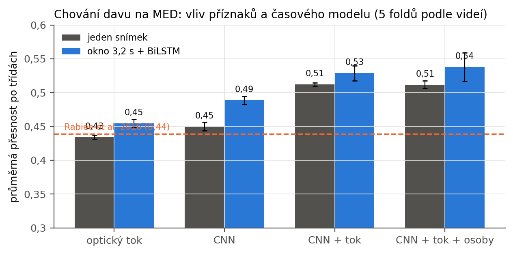
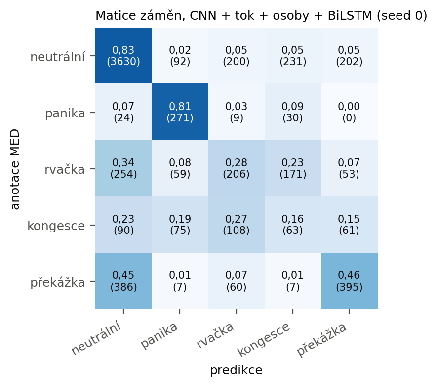
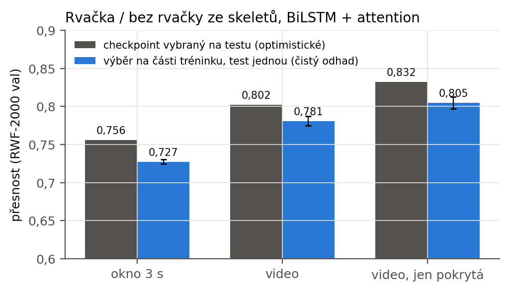
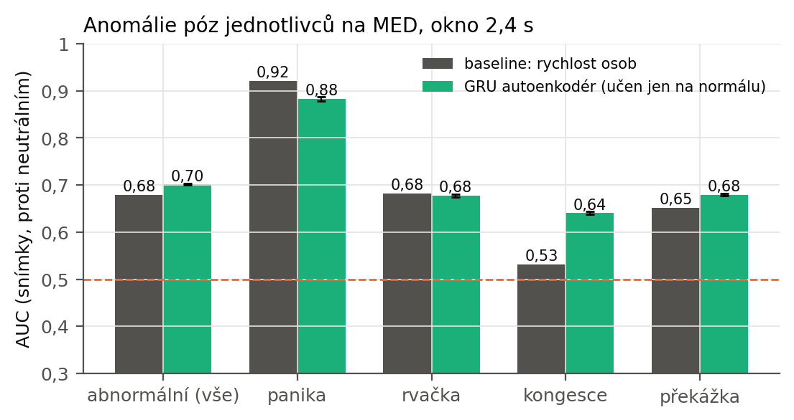

# Y Klasifikace chování osob a davu

> Koncept kapitoly (2026-10-28). Čísla pocházejí z `med_results.json`, `rwf_lstm_eval.json` a
> `med_pose_results.json`; obrázky z `docs/figures/` (`med_figures.py`). Části označené [DOPLNIT]
> čekají na výsledky. Číslování „Y“ nahradit skutečným číslem kapitoly.

## Y.1 Motivace a cíl

Zadání práce rozlišuje tři úlohy: rozpoznání normálního a abnormálního pohybu davu jako celku, rozpoznání abnormálních póz jednotlivých osob a rozpoznání interakcí mezi osobami. Společným rysem všech tří je, že rozhodnutí nelze učinit z jediného snímku. Panika je náhlá změna pohybu celé scény, rvačka je sled rychlých, nekoordinovaných pohybů dvou nebo více osob a abnormální póza se projeví teprve jako odchylka od toho, jak se lidé v daném prostředí obvykle pohybují. Každá úloha proto spojuje prostorový popis snímku s modelem jeho vývoje v čase.

Tato kapitola popisuje tři modely, pro každou úlohu jeden, a jejich vyhodnocení. Pro pohyb davu se využívá oficiální anotace Motion Emotion Datasetu (MED) [CITACE], pro interakce dataset RWF-2000 [CITACE] a pro abnormální pózy opět MED, tentokrát na úrovni jednotlivých osob sledovaných v čase. Detekce osob a odhad skeletu, z nichž druhá a třetí úloha vycházejí, jsou popsány v kapitole [ODKAZ]; detekce zbraní, která na skeletovou větev navazuje, v kapitole [ODKAZ].

## Y.2 Data

### Motion Emotion Dataset

MED obsahuje 31 záznamů ze statické kamery umístěné šikmo nad prostranstvím, celkem 44 130 anotovaných snímků při 30 snímcích/s, v rozlišení 854 × 480 px. Každý snímek má přiřazenu jednu z pěti tříd chování: neutrální, panika, rvačka, kongesce a překážka či neobvyklý objekt; část snímků nemá třídu žádnou (zpravidla úvod a závěr záznamu). Rozdělení je výrazně nevyvážené: neutrálních snímků je 26 070, překážky 5 134, rvačky 4 478, kongesce 2 387 a paniky 2 002. Řada videí obsahuje přechod z normálního do abnormálního stavu, což je pro časové modely podstatné, protože hranice mezi třídami leží uvnitř záznamu, ne mezi záznamy.

Anotace je v datasetu uložena jako skript MATLABu s úseky snímků; pro tuto práci byla převedena na pole tříd po snímcích (`med_features.py`). Záznamy se vzorkují 5 snímky/s, což dává 7 355 vzorkovaných snímků. Tím se snižuje redundance sousedních snímků a zároveň to odpovídá tempu, v němž pracuje celý zpracovatelský řetězec práce.

V rané fázi práce vznikl pokus o vlastní anotaci chování jednotlivých osob v MED (chůze, podezřelé chování, běh) interaktivním nástrojem nad sledovanými skelety. Po čtyřech sekvencích a 196 snímcích bylo zřejmé, že ruční sledování osob v davu je příliš pracné a výsledná data (140 snímků chůze, 8 běhu, žádné podezřelé chování) nestačí ani na smysluplné vyhodnocení. Oficiální anotace na úrovni scény, která byla k dispozici od začátku, tak tento pokus nahradila; pro chování jednotlivců byl zvolen přístup bez anotací, popsaný v části Y.5.

### RWF-2000

RWF-2000 [CITACE] je soubor 2 000 pětisekundových klipů z bezpečnostních kamer, rozdělených napůl na rvačky a scény bez rvačky; autoři dataset dělí na 1 600 trénovacích a 400 validačních klipů. Pro skeletovou větev byly všechny klipy zpracovány řetězcem RT-DETR + ViTPose (kapitola [ODKAZ]) při 5 snímcích/s, s jednoduchým sledováním osob podle těžiště skeletu. Výsledkem je pro každý klip množina trajektorií, každá tvořena posloupností 14bodových skeletů jedné osoby. Zpracování 2 007 klipů trvalo 1,9 h.

## Y.3 Chování davu

### Příznaky

Pro každý vzorkovaný snímek se počítají tři skupiny příznaků, které popisují scénu jako celek:

- **Vzhled scény:** 512rozměrný výstup konvoluční sítě ResNet-18 předtrénované na ImageNetu [CITACE] po globálním průměrování poslední vrstvy. Síť se dále netrénuje; zachycuje hustotu a rozložení osob, přítomnost cizích objektů a celkovou strukturu snímku.
- **Pohyb:** optický tok mezi snímkem a snímkem o 0,1 s pozdějším (metoda Farneback [CITACE]) v polovičním rozlišení. Z pole toku se odvozuje 48 statistik: průměr, směrodatná odchylka a percentily velikosti pohybu, podíl pohybujících se pixelů, histogram směrů vážený velikostí a jeho entropie, koherence pohybu (poměr velikosti průměrného vektoru k průměrné velikosti vektorů) a průměrná velikost i podíl pohybu v mřížce 4 × 4. Panika se v těchto příznacích projeví velkým a nekoherentním pohybem, kongesce malým pohybem při vysoké hustotě.
- **Osoby:** detekce osob modelem YOLO11x [CITACE]: počet osob, statistiky výšky a polohy boxů, podíl zakryté plochy a počet osob v mřížce 4 × 4, celkem 24 hodnot. Tyto příznaky cílí na kongesci, kterou vzhled ani pohyb neodlišují od běžného provozu.

### Model a protokol

Příznaky snímku se po standardizaci promítnou lineární vrstvou do 128 rozměrů. Časový model je obousměrná LSTM se 64 skrytými jednotkami v každém směru nad oknem 16 snímků (3,2 s) se středem v klasifikovaném snímku; výstupy přes okno se průměrují a lineární vrstva dává pět tříd. Pro srovnání se trénuje i varianta bez časového modelu, tedy perceptron nad příznaky jediného snímku. Ztráta je křížová entropie s váhami tříd nepřímo úměrnými jejich četnosti; optimalizátor AdamW, 25 epoch s kosinovým poklesem rychlosti učení. Model má řádově 10⁵ parametrů.

Vyhodnocení je křížová validace s pěti skupinami videí sestavenými tak, aby každá obsahovala všechny abnormální třídy; žádné video není současně v trénovací a testovací části. Počet epoch je pevně daný předem a nic se na testovacích videích neladí. Predikce ze všech pěti skupin se sloučí a metriky se počítají nad všemi 31 videi; celý postup se opakuje pro tři náhodné inicializace a uvádí se průměr a směrodatná odchylka. Hlavní metrikou je průměrná přesnost po třídách (průměr recallu jednotlivých tříd), kterou používá i původní článek k datasetu [CITACE] a která není zkreslená převahou neutrální třídy. Doplňuje ji celková přesnost, macro-F1 a plocha pod ROC křivkou pro binární rozhodnutí normální/abnormální.

### Výsledky

**Tabulka Y.1:** Chování davu na MED, pět skupin videí, průměr ze tří inicializací. „Časový model“ = BiLSTM nad oknem 3,2 s; bez něj klasifikace jediného snímku.

| příznaky | časový model | přesnost | prům. přesnost po třídách | macro-F1 | AUC normální/abnormální |
|---|---|---:|---:|---:|---:|
| optický tok | ne | 0,498 | 0,434 | 0,401 | 0,672 |
| optický tok | ano | 0,624 | 0,455 | 0,445 | 0,704 |
| vzhled (CNN) | ne | 0,649 | 0,450 | 0,433 | 0,779 |
| vzhled (CNN) | ano | 0,665 | 0,489 | 0,465 | 0,807 |
| vzhled + tok | ne | 0,689 | 0,512 | 0,510 | 0,795 |
| vzhled + tok | ano | 0,695 | 0,529 | 0,506 | 0,815 |
| vzhled + tok + osoby | ne | 0,687 | 0,512 | 0,509 | 0,798 |
| **vzhled + tok + osoby** | **ano** | **0,699** | **0,538 ± 0,025** | **0,522** | **0,825** |
| Rabiee et al. 2016, nízkoúrovňové příznaky | | | 0,387 | | |
| Rabiee et al. 2016, reprezentace přes emoce | | | 0,436–0,439 | | |

Z tabulky plynou tři zjištění. Za prvé, časový model zlepšuje výsledek ve všech čtyřech skupinách příznaků, o 2 až 4 body průměrné přesnosti po třídách a o 1 až 3 body AUC. Největší přínos má u optického toku, kde jednotlivý snímek zachytí jen okamžitou rychlost, kdežto okno zachytí její změnu. Za druhé, vzhled a pohyb se doplňují: vzhled rozpozná překážku a rvačku, které pohyb nevidí, pohyb rozpozná paniku, kterou vzhled rozlišuje špatně (F1 0,43 proti 0,76). Za třetí, příznaky z detekce osob přidávají jen málo (+0,01) a jejich přínos je v mezích rozptylu mezi inicializacemi.

Po třídách je obraz nerovnoměrný: neutrální stav má F1 0,83 a panika 0,69, překážka 0,51, rvačka 0,38 a kongesce 0,20. Matice záměn ukazuje, že rvačka se nejčastěji zaměňuje za neutrální stav a za kongesci. To je očekávatelné: rvačka v MED je lokální událost několika osob uprostřed davu, který se jinak chová normálně, a příznaky popisující celý snímek ji z velké části nevidí. Právě pro tuto třídu je určen skeletový model z části Y.4. Kongesce je nejhůře rozpoznatelná třída, protože se od hustého, ale normálního provozu liší jen pomalostí pohybu; delší okno 32 snímků (6,4 s) ji zlepší na F1 0,38, ale zhorší překážku a rvačku, takže v hlavní konfiguraci zůstává okno 3,2 s.

Srovnání s původním článkem [CITACE] je příznivé: nejlepší varianta dosahuje průměrné přesnosti po třídách 0,54 proti 0,44, a to při přísnějším protokolu (pět skupin videí místo vynechání jediné sekvence). Autoři článku zároveň uvádějí, že se znalostí anotovaných emocí davu by přesnost stoupla na 0,84; to je ovšem horní mez s informací, kterou systém v provozu nemá. Rozdíl mezi 0,54 a touto mezí naznačuje, kolik prostoru v úloze zbývá.

## Y.4 Interakce mezi osobami: rozpoznání rvačky ze skeletů

### Model

Vstupem je trajektorie jedné osoby: posloupnost 14bodových skeletů (formát CrowdPose) z řetězce RT-DETR + ViTPose. Každý skelet se normalizuje posunem do středu boků a dělením délkou trupu, aby nezáležel na poloze ani vzdálenosti osoby od kamery; k souřadnicím se přidá jejich rozdíl mezi sousedními snímky jako rychlost kloubů. Z trajektorie se vybírají okna 15 snímků (3 s) s krokem 5 snímků. Model je obousměrná LSTM se 64 jednotkami, nad jejím výstupem vrstva vícehlavé pozornosti se dvěma hlavami a reziduálním spojením, průměrování přes čas a dvouvrstvý klasifikátor; dropout 0,5, celkem asi 145 000 parametrů. Trénovací okna se augmentují zrcadlením s prohozením levé a pravé strany těla, malým otočením, změnou měřítka, šumem a náhodným vynecháním 10 % kloubů (napodobení zákrytu). Klasifikace je binární, rvačka / bez rvačky; třída klipu se přiřadí každému oknu každé osoby v něm.

Dřívější, větší varianta (128 jednotek, dvě vrstvy LSTM, čtyři hlavy, ~963 000 parametrů) dosahovala stejné přesnosti při výrazném přeučení (přesnost na tréninku 0,995 proti 0,75 na validaci); menší model s vyšším dropoutem rozdíl snížil na 5 bodů.

### Protokol a problém výběru modelu

RWF-2000 má jedinou oddělenou sadu, validační, a v literatuře se na ní uvádějí výsledky. Původní trénink vybíral nejlepší epochu právě podle přesnosti na této sadě, takže výsledek 0,756 je mírně nadhodnocený. Pro čistý odhad byl proto model natrénován znovu se stejnými hyperparametry, ale s výběrem epochy na 15 % trénovacích klipů (stratifikovaně podle třídy), a validační sada byla použita jen jednou, jako test. Postup se opakoval pro tři inicializace.

Výsledky se uvádějí na dvou úrovních. Na úrovni oken je to klasifikace každého tříekundového úseku každé osoby. Na úrovni klipu se pravděpodobnost rvačky průměruje přes všechna okna všech osob v klipu; to je úroveň, na níž se dataset hodnotí v literatuře. Klipy, v nichž žádná osoba nebyla sledována po celé okno (při 25 vzorkovaných snímcích na klip jich je 84 ze 400, z toho 26 rvaček), dostávají předpověď „bez rvačky“ a započítávají se jako chyba, pokud jsou rvačkou.

### Výsledky

**Tabulka Y.2:** RWF-2000, validační sada (400 klipů). Čistý odhad je průměr ± směrodatná odchylka ze tří inicializací.

| úroveň | výběr epochy na testu | čistý odhad | F1 rvačka | AUC |
|---|---:|---:|---:|---:|
| okno (3 s), 2 327 oken | 0,756 | 0,727 ± 0,003 | 0,679 | 0,789 |
| **klip (400)** | 0,802 | **0,781 ± 0,006** | 0,752 | 0,808 |
| klip, jen s aspoň jedním oknem (316) | 0,832 | 0,805 ± 0,008 | 0,812 | 0,869 |

Model dosahuje na úrovni klipu přesnosti 0,78. Výběr epochy na testu nadhodnocuje výsledek o 2 až 3 body, což je rozdíl malý, ale systematický. Omezení na klipy, v nichž vůbec vzniklo okno, zvyšuje přesnost na 0,81; pětina klipů tedy propadá ne kvůli klasifikátoru, ale kvůli tomu, že v pětisekundovém klipu při 5 snímcích/s nebyla žádná osoba sledována tři sekundy v kuse. Kratší okno nebo robustnější sledování by tuto ztrátu snížily.

V literatuře dosahují skeletové metody na RWF-2000 vyšších hodnot: kombinace skeletů a detekce změn 0,90 [CITACE], učení interakcí nad mračny bodů skeletů 0,90 [CITACE], strukturované sdružování klíčových bodů 0,93 [CITACE]. Rozdíl proti 0,78 má několik zdrojů. Model zde klasifikuje každou osobu zvlášť a interakci mezi osobami zachytí jen nepřímo, průměrováním; metody v literatuře vztahy mezi osobami modelují explicitně. Skelety pocházejí z obecného odhadu pózy bez doladění na záběry z kamer, kde je zákryt a nízké rozlišení běžné. A konečně, model je záměrně malý, aby se nepřeučil na 1 600 klipech.

## Y.5 Abnormální pózy jednotlivců

### Přístup bez anotací

Pro pózy jednotlivých osob MED anotaci nemá a vlastní anotace se ukázala neschůdná (část Y.2). Zvolen byl proto přístup, který anotaci anomálií nepotřebuje: model se naučí, jak vypadají trajektorie skeletů v normálních úsecích, a jako abnormální označí to, co neumí dobře reprodukovat. Postup vychází z práce Morais et al. [CITACE], která zavedla rekonstrukci skeletových trajektorií jako kritérium normality.

Vstupem je opět trajektorie jedné osoby z řetězce RT-DETR + ViTPose se sledováním podle těžiště, tentokrát na všech 31 záznamech MED (7 355 vzorkovaných snímků, v průměru 12 až 25 osob na snímek). Každý snímek trajektorie se popisuje dvěma složkami: lokální, tj. skeletem normalizovaným na střed boků a délku trupu, a globální, tj. posunem středu boků od minulého snímku v násobcích délky trupu. Klouby s jistotou pod 0,3 se nahrazují nulou. Okna mají 12 snímků (2,4 s) a berou se jen ze souvislých úseků trajektorie.

Model je autoenkodér se dvěma GRU vrstvami o 64 jednotkách: enkodér shrne okno do jednoho stavu, dekodér z něj okno rekonstruuje v obráceném pořadí. Trénuje se jen na oknech, jejichž střed leží v neutrálním snímku trénovacích videí, 30 epoch. Skóre anomálie okna je průměrná kvadratická chyba rekonstrukce; skóre snímku je průměr tří nejvyšších skóre oken se středem v tomto snímku, vyhlazený mediánovým filtrem přes pět snímků. Pro posouzení, co učení přidává, slouží baseline bez učení: skóre snímku je průměrná rychlost tří nejrychlejších osob.

Vyhodnocení používá stejných pět skupin videí jako část Y.3. Metrikou je plocha pod ROC křivkou na úrovni snímků, jednak pro rozhodnutí neutrální/abnormální, jednak pro každou abnormální třídu zvlášť proti neutrálním snímkům. Tím je vidět, které třídy se v pózách jednotlivců vůbec projevují: panika a rvačka ano, překážka a kongesce nikoli, protože ta je vlastností davu, ne jednotlivce.

### Výsledky

Z trajektorií vzniklo 62 322 oken. Tabulka Y.3 a obrázek Y.4 srovnávají autoenkodér s baseline založenou jen na rychlosti.

**Tabulka Y.3:** Anomálie póz jednotlivců na MED: AUC na úrovni snímků, abnormální třída proti neutrálním snímkům, pět skupin videí. Autoenkodér: průměr ± směrodatná odchylka ze tří inicializací.

| skóre snímku | abnormální (vše) | panika | rvačka | kongesce | překážka |
|---|---:|---:|---:|---:|---:|
| baseline: rychlost tří nejrychlejších osob | 0,680 | **0,921** | 0,682 | 0,532 | 0,652 |
| GRU autoenkodér (učen jen na normálu) | **0,701 ± 0,001** | 0,883 ± 0,004 | 0,678 ± 0,003 | **0,641 ± 0,003** | **0,679 ± 0,002** |

Výsledek je střízlivý. Autoenkodér odděluje abnormální snímky od neutrálních s AUC 0,70, jen o 0,02 lépe než prostá rychlost osob. Rozdíl je ale v tom, co která metoda vidí. Paniku rozpozná nejlépe rychlost (AUC 0,92): utíkající lidé jsou jednoduše rychlí a naučený model regularity k tomu nic nepřidá, naopak o něco ztrácí, protože rychlý běh částečně viděl i v normálních úsecích. U kongesce je tomu naopak: rychlost ji nerozliší vůbec (0,53, tedy téměř náhoda), zatímco autoenkodér dosahuje 0,64, protože hustě natlačené, pomalu se sunoucí postavy mají jiné držení těla a jiné trajektorie než normální chůze. Překážku autoenkodér zlepšuje méně (0,65 → 0,68). Rvačku nerozliší dobře ani jedna metoda (0,68): skelety v bitce jsou kvůli zákrytům a rychlému pohybu nekvalitní a sledování osob se trhá, takže právě v okamžiku rvačky je k dispozici nejméně souvislých oken.

Pro praxi z toho plyne, že samotná anomálie pózy jednotlivce není na MED silným signálem a je vhodná jako doplněk k modelu davu z části Y.3, který tytéž třídy rozpoznává přes celou scénu výrazně lépe (AUC 0,83). Její výhodou zůstává, že nepotřebuje anotace anomálií a lokalizuje osobu, ne jen snímek.

## Y.6 Omezení a diskuse

Všechny tři modely sdílejí omezení plynoucí z dat. MED má 31 záznamů z jediné kamery a jediného místa; pět skupin videí brání úniku informace mezi tréninkem a testem, ale neříká nic o přenosu na jinou scénu. Některé třídy jsou v datech zastoupeny několika málo videi (panika 11, kongesce 7), takže výsledky po třídách mají velký rozptyl, patrný i ve směrodatných odchylkách tabulky Y.1. RWF-2000 je větší a rozmanitější, ale klipy jsou krátké a bez časové lokalizace rvačky uvnitř klipu.

Druhé omezení je ve skeletech. Odhad pózy nebyl na záběry z kamer dolaďován, a sledování osob podle těžiště se v davu trhá; v RWF-2000 to stojí pětinu klipů. Skeletové metody jsou navíc slepé k tomu, co osoba drží, což řeší samostatná detekce zbraní (kapitola [ODKAZ]).

Třetí omezení je metodické. Hyperparametry modelů nebyly laděny systematicky, vycházejí z běžných hodnot a několika pokusů; počet epoch je pevný. Je pravděpodobné, že ladění na vyčleněné části tréninku by výsledky zlepšilo, ale za cenu dalšího dělení už tak malých dat.

## Y.7 Shrnutí

Pro pohyb davu byl na oficiálních anotacích MED natrénován prostorově-temporální model spojující vzhled scény, optický tok a detekci osob s obousměrnou LSTM. Při vyhodnocení po videích dosahuje průměrné přesnosti po třídách 0,54 a AUC 0,83 pro rozhodnutí normální/abnormální, proti 0,44 v původním článku k datasetu; časová složka zlepšuje všechny varianty. Pro interakce mezi osobami rozpoznává model nad skeletovými trajektoriemi rvačku na RWF-2000 s přesností 0,78 na úrovni klipu, s poctivým protokolem výběru modelu; slabinou je sledování osob, kvůli kterému pětina klipů nemá žádné okno. Pro abnormální pózy jednotlivců byl bez anotací natrénován autoenkodér skeletových trajektorií na normálních úsecích MED; odděluje abnormální snímky s AUC 0,70, jen mírně nad rychlostní baseline (0,68), ale na rozdíl od ní zachytí kongesci (0,64 proti 0,53), takže je užitečný jako doplněk modelu davu, ne jako samostatný detektor.

## Poznámky pro autora

- [CITACE]: MED (Rabiee et al., AVSS 2016, arXiv 1607.07646), RWF-2000 (Cheng et al., ICPR 2020), ResNet (He et al. 2016), Farneback 2003, YOLO11 (Ultralytics), Morais et al. CVPR 2019 (Learning Regularity in Skeleton Trajectories), skeletové metody na RWF (viz odkazy v `STAV_PRACE.md`, ověřit čísla v originálech; 93,4 % je z agregátoru).
- Hodnota 0,84 „s anotovanými emocemi“ je z tabulky 2 článku MED (emotion-aware, GT emoce v testu).
- Hodnota 0,439 v tabulce Y.1 je varianta „latent emotion“ článku, 0,436 „emotion-based“; obě dense trajectories.
- Počet videí s panikou (11) a kongescí (7) spočítán z anotace; překážka 10, rvačka 7, čistě neutrální 4.
- Délka zpracování RWF (1,9 h) z `project_state` poznámek, ne z logu v repu; ověřit nebo vypustit.
- Odstavec o „dřívější větší variantě“ RWF modelu vychází z `training_history_v1.json` a logu `logs/train_lstm_20260509-181150.log`.
