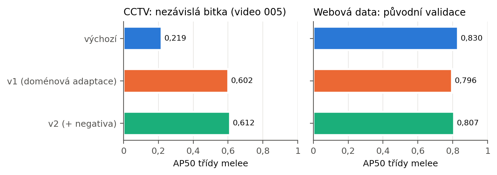
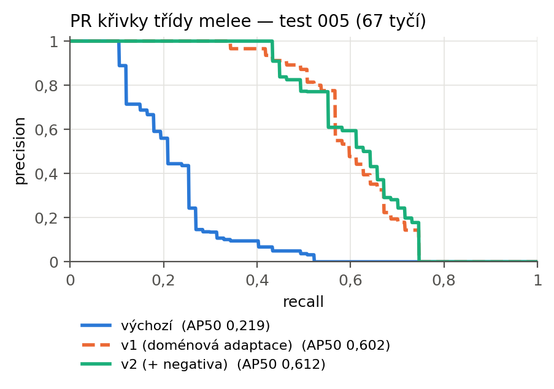
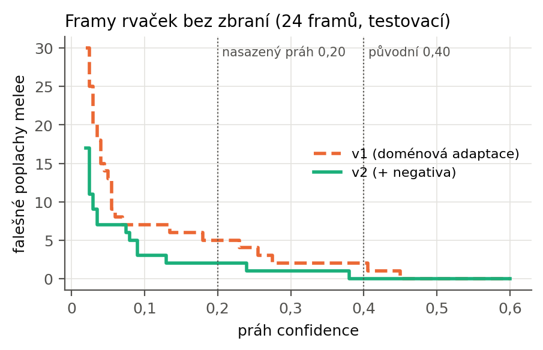
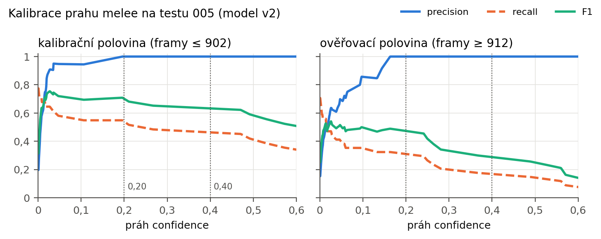
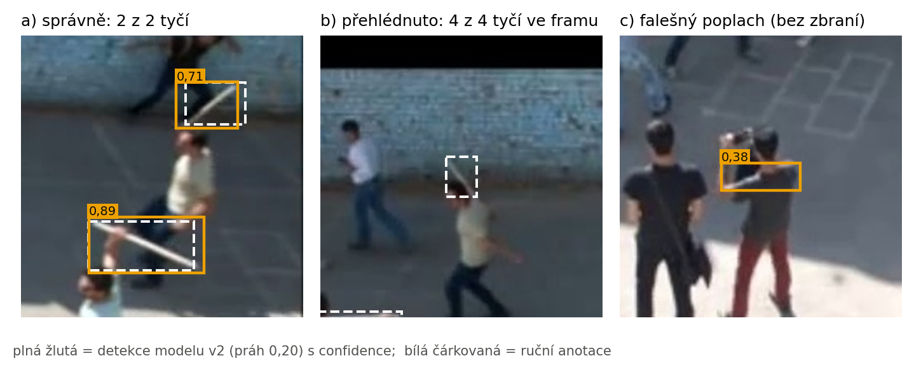

# Trénink detektoru podezřelých předmětů — technická zpráva

**Datum:** 2026-08-02 až 2026-08-04 (hlavní trénink), 2026-09 až 2026-10-02 (anotace a domain adaptation)
**Cíl:** implementace bodu 4 pipeline („Detekce podezřelých předmětů", v README
dosud označeno jako neimplementováno)
**Výsledek:** natrénovaný YOLO11l detektor 3 tříd, mAP50 0,775 na validačním splitu;
po domain adaptation (§6b) na CCTV záběrech recall `melee` 0,10 → 0,50 za cenu
poklesu na původních datech 0,777 → 0,755

Doprovodné dokumenty:
- [`DATASETS.md`](DATASETS.md) — kompletní rozpis datasetů, licence, mapování tříd
- [`artifacts/`](artifacts/) — `results.csv`, grafy, confusion matice, batch vizualizace, logy
- [`med_test/`](med_test/) — výstupy testu na reálných MED framech
- [`scripts/`](scripts/) — kopie použitých skriptů

---

## 1. Zadání a volba přístupu

### 1.1 Východiska

Rešerše `weapon_detectors.md` (2026-06-26) došla k závěru, že **hotový
předtrénovaný detektor melee zbraní v produkční kvalitě neexistuje** a že
realistickou cestou je fine-tune vlastního modelu na existujících datasetech.

### 1.2 Volba modelu

| Alternativa | Odhad | Rozhodnutí |
|---|---|---|
| **YOLO11l fine-tune @ 960 px** | ~25 min/epochu | ✅ **zvoleno** |
| YOLO11x fine-tune @ 640 px | podobný čas | ❌ |
| RT-DETR trénink od nuly | 15–60 h | ❌ |

**Proč fine-tune, ne trénink od nuly:** 24 tisíc obrázků je na trénink
transformeru od nuly málo; RT-DETR from scratch by při 300 epochách trval
desítky hodin a prohrál by s fine-tunem předtrénovaných COCO vah. RT-DETR je
navíc v pipeline už použit na detekci osob, kde se osvědčil.

**Proč `l` @ 960 px a ne `x` @ 640 px:** u zbraní ve CCTV záběru je limitujícím
faktorem **velikost objektu**, ne kapacita backbone. Pálka v záběru z bezpečnostní
kamery má desítky pixelů. Vyšší vstupní rozlišení proto přináší víc než hlubší síť
při srovnatelném výpočetním čase.

### 1.3 Volba tříd: 3 místo původních 6

Původní plán (podle `RTDETR_TRAINING_GUIDE.md`) počítal se 7 třídami
`gun, knife, rifle, weapon, backpack, bag, suspicious_object`, upravený plán
se 6 (`gun, knife, melee, backpack, handbag, suitcase`).

Ověření dostupnosti dat vedlo k **3 třídám: `gun`, `knife`, `melee`**:

- `handbag` má ve všech dostupných datasetech dohromady jen ~200 instancí,
  `suitcase` ~2 700, `backpack` 819.
- **COCO je má lépe.** Předtrénovaný YOLO11x, který už v pipeline je, detekuje
  `backpack`/`handbag`/`suitcase` ze 118 000 COCO obrázků. Fine-tune z několika
  set instancí by byl horší.

Vlastní model tedy dělá výhradně to, co COCO neumí. Zavazadla zůstávají na COCO.
Podrobné odůvodnění v [`DATASETS.md`](DATASETS.md) §3.2.

---

## 2. Hardware a prostředí

| | |
|---|---|
| Stroj | NVIDIA DGX Spark (`spark-3a9e`) |
| GPU | NVIDIA GB10, compute capability **sm_121** |
| CPU / RAM | 20 jader aarch64 / **121 GB unified memory** |
| OS | Ubuntu 24.04 LTS, Python 3.12.3 |
| PyTorch | 2.13.0+cu130 |
| Ultralytics | 8.4.115 |

### 2.1 Dvě platformní zvláštnosti

**Torch musí být build pro CUDA 13.0.** GB10 hlásí capability sm_121, ale
dostupné wheely obsahují cubiny jen do `sm_120` (`torch.cuda.get_arch_list()`
→ `['sm_80','sm_90','sm_100','sm_110','sm_120']`). Funguje to díky
minor-version kompatibilitě v rámci architektury Blackwell 12.x — ověřeno
kontrolním výpočtem na GPU. Starší torch buildy na tomto GPU selžou.

**Unified memory není totéž jako VRAM.** Spark má 121 GB paměti sdílené mezi
CPU a GPU, ale propustnost LPDDR5X je ~273 GB/s proti ~1 TB/s u desktopové
GDDR6X. Trénink je proto **bandwidth-bound**: velká paměť nezvyšuje průchodnost
a **zvětšování batche nepomáhá**. Naměřeno ~2,2 s/iteraci při batch 32 a 960 px,
tj. ~14 obrázků/s. Čas tréninku nelze na této platformě odhadovat podle
velikosti paměti.

Před tréninkem bylo nutné zastavit Docker container s vLLM (medgemma-27b),
který držel ~80 z 121 GB.

---

## 3. Konstrukce datasetu

Podrobně v [`DATASETS.md`](DATASETS.md). Souhrn:

```
7 datasetů stáhnuto (3,3 GB)
46 173 kandidátních obrázků
  → 41 124 unikátních        (−5 049 duplicit, SHA-1 deduplikace)
  → 24 340 obrázků           (−16 784 zahozeno pro nezmapovaný label)
```

| Split | Obrázků | | Třída | Instancí |
|---|---|---|---|---|
| train | 19 924 | | `gun` | 14 218 (50,5 %) |
| val | 3 503 | | `melee` | 10 730 (38,1 %) |
| test | 913 | | `knife` | 3 208 (11,4 %) |

### 3.1 Tři metodické problémy, které bylo nutné vyřešit

**(a) Nebezpečné zahození labelu.** Když se z obrázku odstraní label zbraňové
třídy a obrázek se v datasetu ponechá, stane se z něj *pozadí* a model se učí,
že zbraň je pozadí. Skript proto rozlišuje bezpečné zahození (`person`, `ball`,
`blood` — obrázek zůstává) od nejednoznačného (`weapon`, `eto` — zahodí se celý
obrázek).

**(b) Deduplikace.** Veřejné weapon datasety na Roboflow jsou navzájem forky.
Bez deduplikace by tentýž obrázek byl v trénovacím i validačním splitu a
validační mAP by byla nadhodnocená. Odstraněno **5 049 duplicit (10,9 %)**
podle SHA-1 obsahu, s prioritou `val` > `test` > `train`, aby se validace
nekontaminovala.

**(c) Polygonové anotace.** Exporty `rhackathon` a `baseball-v1` míchají
bounding boxy s polygony (4–87 bodů). Nalezeno **549 řádků**. Naivní přečtení
prvních čtyř čísel jako `cx cy w h` by dalo úplně jiný box; polygony se proto
převádějí na opsaný bounding box.

### 3.2 Ověřování dat pohledem, ne dokumentací

Tři datasety doporučené rešerší se ukázaly jako nepoužitelné a **žádný z těch
problémů nebyl patrný z metadat ani z popisu**:

| Dataset | Problém |
|---|---|
| `weapons-085lm` | Názvy tříd jsou zbytky README textu (`'=============================='`) |
| `weapons-dataset-os1ki` | Žádné melee třídy; navíc bez exportované verze |
| `weapon-detection-cabwp` | Jediná třída `weapon` = **směs pistolí, pušek a nožů** |

Poslední případ byl nejzávažnější: šlo o největší dataset (15 981 obrázků,
16 966 boxů). Vizuální kontrola vzorku 48 výřezů prokázala smíšený obsah, takže
namapování `weapon → gun` by vložilo nože do třídy `gun`. **Dataset byl vyřazen
celý.**

Naopak dvě mapování byla vizuální kontrolou potvrzena:
- `heavy-weapon` (11 598 boxů) = výhradně dlouhé palné zbraně → `gun`
- `0` (nepojmenovaná třída) = baseballové pálky → `melee`

A jedno mapování bylo na základě náhledu **opraveno**: `short sword` obsahuje
dýky vizuálně nerozeznatelné od velkých nožů, takže konkurovaly třídě `knife`.
Přesunuty z `melee` do `knife` (501 instancí), čímž se zároveň posílila
nejslabší třída.

**Metodický závěr:** Roboflow API vrací u některých datasetů jiné třídy než
skutečný export. Třídy je nutné čtete z exportovaného `data.yaml` a obsah
nejednoznačných tříd vizuálně ověřit.

---

## 4. Průběh tréninku

Celkem tři běhy. První dva byly ukončeny, třetí je finální.

| Běh | Konfigurace | Výsledek |
|---|---|---|
| 1 | `workers=12`, `optimizer=auto` | ukončen — 30,6 min/epochu, divergoval |
| 2 | `workers=6`, `optimizer=auto` | ukončen — 24,5 min/epochu, divergoval |
| 3 | `workers=6`, **`optimizer=SGD`, `lr0=0.005`** | ✅ **finální**, 90 epoch / 43,4 h |

### 4.1 Optimalizace propustnosti (běh 1 → 2)

Snížení `workers` z 12 na 6 zkrátilo epochu z 30,6 na 24,5 min (**−20 %**).
Efekt na paměť: `available` 20 → 48 GB, shm 26 → 15 GB, swap 4 → 0 GB.
Na unified memory architektuře odebírají dataloader workery paměť ze stejného
poolu jako GPU alokace. Load average byl přitom jen ~2 z 20 jader, takže
12 workerů nebylo potřeba.

### 4.2 Divergence: `optimizer='auto'` (běhy 1 a 2)

**Nejzávažnější problém celého tréninku.** Ultralytics 8.4.115 při
`optimizer='auto'` vybral **`MuSGD(lr=0.01)`**. Warmup fáze (`warmup_epochs=3`)
ho vyženula na trojnásobek a model divergoval:

| Epocha | `lr/pg0` | train cls_loss | **val cls_loss** | mAP50 |
|---|---|---|---|---|
| 1 | 0,00998 | 2,000 | 2,466 | 0,3042 |
| 2 | 0,01998 | 2,051 | 3,232 | 0,2381 |
| 3 | 0,02995 | 2,277 | **6,119** | **0,0999** |

Validační `cls_loss` vzrostla 2,5×, trénovací loss rostla také, mAP50 spadla
na třetinu. To je jednoznačná divergence, nikoli šum.

**Příčina:** MuSGD je optimizer založený na metodě Muon, která používá výrazně
menší efektivní learning rate pro maticové parametry než klasické SGD. Hodnota
`lr=0.01` je pro něj na tomto datasetu příliš vysoká.

**Řešení:** explicitní `optimizer='SGD', lr0=0.005`. Efekt byl okamžitý —
mAP50 v první epoše **0,558 proti 0,304** u MuSGD.

**Doporučení:** na této verzi ultralytics `optimizer='auto'` nepoužívat.
Data z divergujícího běhu jsou v `artifacts/weapons_yolo11l_960_w6_musgd_diverged/`.

### 4.3 Metodická poznámka: měření rychlosti

Během běhu 2 jsem dvakrát nesprávně vyhodnotil zpomalení tréninku. Hodnota
`s/it` v progress baru ultralytics je **klouzavý průměr**, který na začátku
každé epochy vyskočí 2–3× (restart dataloader workerů, prázdný mosaic buffer)
a během několika minut se srovná. Vzorkování v tomto okamžiku vedlo k odhadům
68 až 123 hodin, které byly nereálné.

Ověření pomocí kontinuálního vzorkování (49 vzorků, `artifacts/rate_samples.csv`)
prokázalo, že korelace mezi volnou pamětí a tempem je slabá (r = −0,32) a že
swap byl nulový. Epochy 2 a 3 měly identickou paměť a dvojnásobně jiné tempo.

**Správnou metrikou je čas epochy z `results.csv`**, nikoli okamžité `s/it`.

### 4.4 Finální konfigurace

```python
model      = yolo11l.pt        # předtrénované COCO váhy
imgsz      = 960
epochs     = 100               # early stop v 90
batch      = 32
workers    = 6
optimizer  = SGD               # NE 'auto'
lr0        = 0.005
lrf        = 0.01              # cos_lr=True
momentum   = 0.937
weight_decay = 0.0005
warmup_epochs = 3.0
patience   = 25
amp        = True
seed       = 0
# augmentace mířená na domain gap web-foto -> CCTV shora
degrees = 10.0    scale = 0.6    translate = 0.15    fliplr = 0.5
mosaic  = 1.0     close_mosaic = 10                  mixup = 0.1
hsv_h = 0.015     hsv_s = 0.7    hsv_v = 0.4
```

Plná konfigurace v `artifacts/weapons_sgd_lr005/args.yaml`.

### 4.5 Vývoj metrik

| Epocha | mAP50 | mAP50-95 | Precision | Recall | val cls_loss | lr |
|---|---|---|---|---|---|---|
| 1 | 0,5582 | 0,2531 | 0,617 | 0,555 | 1,679 | 0,00166 |
| 2 | 0,5268 | 0,2690 | 0,537 | 0,535 | 1,878 | 0,00333 |
| 3 | 0,2515 | 0,1079 | 0,393 | 0,287 | 3,057 | 0,00499 |
| 5 | 0,4077 | 0,1998 | 0,519 | 0,422 | 2,229 | 0,00498 |
| 10 | 0,6234 | 0,3619 | 0,732 | 0,569 | 1,590 | 0,00490 |
| 20 | 0,7142 | 0,4493 | 0,811 | 0,653 | 1,208 | 0,00457 |
| 30 | 0,7532 | 0,4884 | 0,835 | 0,684 | 1,053 | 0,00404 |
| 40 | 0,7638 | 0,5023 | 0,849 | 0,707 | 1,006 | 0,00336 |
| 50 | 0,7712 | 0,5202 | 0,855 | 0,726 | 0,955 | 0,00260 |
| 60 | 0,7764 | 0,5229 | 0,868 | 0,728 | 0,935 | 0,00183 |
| **65** | **0,7771** | **0,5249** | 0,878 | 0,725 | 0,927 | 0,00147 |
| 70 | 0,7790 | 0,5242 | 0,879 | 0,729 | 0,919 | 0,00113 |
| 76 | **0,7804** | 0,5223 | 0,880 | 0,733 | 0,912 | 0,00077 |
| 90 | 0,7781 | 0,5145 | 0,879 | 0,728 | 0,901 | 0,00020 |

Propad v epoše 3 je způsoben dokončením warmupu (lr dosáhne cílových 0,005).
Od epochy 4 metriky monotónně stoupají. Graf v `artifacts/weapons_sgd_lr005/results.png`.

### 4.6 Ukončení tréninku

```
EarlyStopping: Training stopped early as no improvement observed in last 25 epochs.
Best results observed at epoch 65, best model saved as best.pt.
90 epochs completed in 43.412 hours.
```

**Pozor na výběr nejlepší epochy.** Ultralytics vyhodnocuje `patience` podle
**fitness = 0,1 · mAP50 + 0,9 · mAP50-95**, nikoli podle mAP50:

- nejlepší **fitness**: epocha **65** (0,5501) → `best.pt`
- nejlepší **mAP50**: epocha 76 (0,7804)

Proto se trénink zastavil v epoše 90 (= 65 + 25) a `best.pt` je z epochy 65.
Rozdíl mezi epochami 65 a 76 je zanedbatelný (mAP50 0,777 vs. 0,780;
mAP50-95 0,525 vs. 0,522). Volba podle fitness preferuje přesnější lokalizaci.

---

## 5. Výsledky

Váhy: `runs/detect/runs/weapons/weapons_sgd_lr005/weights/best.pt` (49 MB, epocha 65)

### 5.1 Validační split (hlavní metrika)

3 503 obrázků, 4 058 instancí

| Třída | Precision | Recall | mAP50 | mAP50-95 |
|---|---|---|---|---|
| `gun` | 0,878 | 0,822 | **0,884** | 0,634 |
| `melee` | 0,871 | 0,763 | **0,830** | 0,533 |
| `knife` | 0,884 | **0,587** | **0,611** | 0,403 |
| **celkem** | **0,878** | **0,724** | **0,775** | **0,523** |

### 5.2 Proč se neuvádí testovací split

Testovací split (913 obrázků) vychází **lépe** — mAP50 0,855, u `knife` dokonce
0,955. Není to však tvrdší benchmark, ale **užší a snazší**: obsahuje pouze
3 z 5 zdrojových datasetů a **ani jeden nůž z nejzašuměnějšího `yolov7test`**
(viz [`DATASETS.md`](DATASETS.md) §6.4). Uvádět 0,855 jako výsledek modelu by
bylo nadhodnocení.

### 5.3 Slabina třídy `knife`

Precision 0,884 při recall 0,587 znamená, že **model označí nůž spolehlivě,
ale přehlédne ~41 % nožů**. Pro detektor hrozeb je to horší typ chyby než
false positive: false negative je propuštěná hrozba.

Příčina je nevyváženost datasetu (`knife` 3 208 instancí proti `gun` 14 218,
poměr 1 : 4,4).

### 5.4 Volba confidence thresholdů z F1 křivky

Thresholdy byly odečteny z F1 křivky na validačním splitu
(`artifacts/thresholds_result.txt`), ne odhadnuty:

| Třída | max F1 při conf | max F1 | **zvoleno** | P | R |
|---|---|---|---|---|---|
| `gun` | 0,411 | 0,851 | **0,35** | 0,831 | 0,852 |
| `knife` | 0,388 | 0,709 | **0,30** | ~0,85 | ~0,60 |
| `melee` | 0,494 | 0,817 | **0,40** | 0,806 | 0,792 |

Zvolené hodnoty leží mírně **pod** bodem maxima F1, protože downstream ARMED
logika (`update_armed_status`) vyžaduje detekci zápěstí u boxu zbraně, a část
false positives tedy odfiltruje sama. Vychýlení k recallu se proto vyplatí.

### 5.5 Oprava původní domněnky: u `knife` threshold nepomůže

Původně jsem předpokládal, že vysoká precision třídy `knife` (0,884) dává
prostor snížit threshold a získat recall. **Data z F1 křivky to vyvracejí:**

| conf | precision | recall |
|---|---|---|
| 0,55 | 0,896 | 0,574 |
| 0,45 | 0,885 | 0,590 |
| 0,35 | 0,861 | 0,601 |
| 0,25 | 0,844 | 0,608 |
| **0,12** | **0,771** | **0,621** |

Snížení prahu z 0,55 na 0,12 zvedne recall jen z 0,574 na **0,621** (+0,047)
za cenu poklesu precision o 0,125. F1 křivka je mezi 0,25 a 0,45 prakticky
plochá (0,706–0,708).

**Chybějící nože tedy nejsou slabé detekce pod prahem — model je nedetekuje
vůbec.** Ladění thresholdu na tom nic nezmění. To je konzistentní s neúspěchem
oversamplingu (§6a): oba experimenty ukazují na stejnou příčinu — nedostatečnou
rozmanitost trénovacích dat, kterou nelze obejít ani převážením, ani
nastavením prahu. Jediným řešením jsou nová anotovaná data.

---

## 6. Test na reálných MED framech (domain-gap test)

**Nejdůležitější část vyhodnocení.** Žádná metrika z validačního splitu nemůže
odpovědět na otázku, jak model funguje na cílové doméně, protože validační split
má stejnou distribuci jako trénink.

Skript `test_on_med.py`, 208 upscalovaných MED framů (videa 001, 002, 004),
`conf ≥ 0,25`, `imgsz=960`. Výstupy v [`med_test/`](med_test/).

### 6.1 Kvantitativní výsledek

| | |
|---|---|
| Framů | 208 |
| Framů s detekcí | 17 (8,2 %) |
| Detekcí celkem | **17** |
| `melee` | 15 (conf průměr 0,408; max **0,684**) |
| `gun` | 2 (conf průměr 0,331) |
| `knife` | 0 |

Rozdělení podle confidence: 0,25–0,4 → 9; 0,4–0,6 → 7; 0,6–0,8 → 1;
**nad 0,8 → 0**.

### 6.2 Kvalitativní analýza

Ukázalo se, že **MED video 004 je hromadná bitka, ve které lidé skutečně drží
improvizované zbraně** — původní předpoklad, že MED zbraně neobsahuje, byl mylný.
Test tak má reálnou vypovídací hodnotu.

**Pravdivá detekce** (`med_test/annotated/004_004_0065.jpg`, `melee 0,68`):
model správně označil podlouhlý předmět v ruce osoby v davu, při pohledu shora,
tedy plně v cílové doméně. **Domain transfer tedy alespoň částečně funguje.**

**Nenalezená zbraň** (`med_test/annotated/004_004_0062.jpg`): ve stejném videu
drží jiná osoba **jasně viditelnou dlouhou bílou tyč** přes celou šíři těla —
a model ji **nedetekoval**. Ve snímku je to nejnápadnější melee předmět.

**False positive**: ve stejném snímku model označil `gun 0,35` na ruce/předloktí
osoby. Podobný FP režim je patrný i u `melee 0,55`
(`004_004_0029.jpg`) — obnažené předloktí má při tomto rozlišení podobný tvar
i světlost jako tyč: podlouhlé, světlé, zužující se.

### 6.3 Závěr testu

**Domain gap je potvrzen a má konkrétní, identifikovatelnou příčinu.**

Model přehlédne dlouhé tyče a hole, protože třída `melee` byla natrénována
převážně na **baseballových pálkách** (72,7 % instancí ze sportovních fotografií)
— tj. na krátkých kónických objektech ve specifickém kontextu. Dlouhá tenká tyč
je jiný tvar a v trénovacích datech se nevyskytuje.

To je **přímý a měřitelný důsledek mezery zdokumentované v `weapon_detectors.md`**:
holá tyč či hůl jako anotovaná třída v žádném dostupném veřejném datasetu
neexistuje (ověřeno opakovaně, viz [`DATASETS.md`](DATASETS.md) §3.1).

Model tedy **není připraven na spolehlivou detekci melee zbraní v CCTV**.
Nízký počet detekcí (17 na 208 framů, žádná nad conf 0,8) znamená, že model
je na cílové doméně konzervativní — nezaplavuje výstup false positives, ale
také většinu hrozeb nenajde.

---

## 6a. Neúspěšný experiment: oversampling třídy `knife`

**Negativní výsledek.** Zdokumentován, protože vylučuje jedno zdánlivě zjevné
řešení a ukazuje na skutečnou příčinu problému.

### Hypotéza

Nízký recall třídy `knife` (0,587) je způsoben nevyvážeností datasetu
(`knife` 3 208 instancí proti `gun` 14 218, poměr 1 : 4,4). Oversampling
trénovacího splitu by měl poměr srovnat a recall zvýšit.

### Provedení

Skript `oversample_knife.py`: každý trénovací obrázek obsahující `knife` byl
zařazen **3×** (hardlinky, bez nároku na místo). Validační a testovací split
zůstaly **nezměněny**, aby byly metriky srovnatelné.

```
train: 19 924 → 24 688 obrázků
knife instance (train): 2 472 → 7 281
poměr gun:knife: 4,4 : 1 → 1,6 : 1
```

Fine-tune z `best.pt` (epocha 65 hlavního běhu), `lr0=0.001`, `lrf=0.05`,
`warmup_epochs=1`, 12 epoch, `patience=6`. Early stop v epoše 8, celkem 4,1 h.

### Výsledek: hypotéza vyvrácena

Srovnání na **identickém** validačním splitu (3 503 obrázků, 4 058 instancí):

| Metrika | Původní model | Po oversamplingu | Rozdíl |
|---|---|---|---|
| **`knife` recall** | **0,587** | **0,585** | **−0,002** |
| `knife` precision | 0,884 | 0,847 | −0,037 |
| `knife` mAP50 | 0,611 | 0,601 | −0,010 |
| `knife` mAP50-95 | 0,403 | 0,383 | −0,020 |
| `gun` mAP50 | 0,884 | 0,878 | −0,006 |
| `melee` mAP50 | 0,830 | 0,831 | +0,001 |
| **celkem mAP50** | **0,775** | **0,770** | **−0,005** |
| **celkem mAP50-95** | **0,523** | **0,512** | **−0,011** |

Recall se **nezvýšil vůbec** a model je celkově mírně horší. Nejlepší epocha
byla hned první (mAP50 0,7711), dále metriky pouze klesaly — typický obraz
fine-tunu, který nepřináší novou informaci.

### Interpretace

Oversampling **duplikováním nepřidává informaci**. Model tytéž nože během
65 epoch hlavního tréninku viděl mnohokrát; trojnásobné opakování pouze
převáží loss funkci ke stejným příkladům. Navíc duplikáty v kombinaci s mosaic
augmentací vytvářejí korelované dávky, což může konvergenci mírně zhoršit —
což pozorovaný pokles precision (0,884 → 0,847) podporuje.

**Skutečná příčina nízkého recallu není nevyváženost, ale nedostatečná
rozmanitost dat.** 3 208 instancí nožů pochází z omezeného počtu zdrojů,
přičemž validační split obsahuje i vizuálně obtížnější nože z datasetu
`yolov7test`. Model nemůže mít recall na varianty, které nikdy neviděl.

**Důsledek pro další práci:** třídu `knife` nelze zlepšit převážením
existujících dat. Je nutné získat **nové a jiné** anotované nože. Totéž
platí analogicky pro chybějící třídu „tyč/hůl" (§6.3).

**Použitý model zůstává původní** `best.pt` z epochy 65 hlavního běhu.
Artefakty neúspěšného experimentu jsou v
`artifacts/knife_boost_ft_FAILED/` pro doložení.

---

## 6b. Anotace cílové domény a domain adaptation (2026-09 až 10)

Domain-gap test (§6) ukázal, že model na CCTV záběrech shora selhává. Nejúčinnějším
krokem bylo doplnit anotovaná data **z cílové domény** a model na nich dotrénovat.

### 6b.1 Postup anotace

Anotováno s asistencí jazykového modelu (Claude) a jeho subagentů podle závazné
specifikace [`ANNOTATION_SPEC.md`](ANNOTATION_SPEC.md). Výstupy byly před zapsáním
ověřovány, nikoli přebírány.

**Měření přesnosti lokalizace.** Bez pomůcek odhadl model box s **IoU 0,70** — na trénink
příliš volně. S přiblíženým výřezem a **souřadnicovou mřížkou** se souřadnice *odečítají*,
ne hádají, s přesností ±5 px (nástroj `assist_annotate.py`, režimy `overview` a `crop`).
Pro tmavý asfalt a stíny přibylo **percentilové roztažení kontrastu** (`--enhance`), které
rozhodlo případy, kdy se „tyč" ukázala jako dvě předloktí.

**Kalibrace na stejném objektu** (frame 004_0065, tatáž tyč):

| Zdroj boxu | Rozměr | Hodnocení |
|---|---|---|
| Natrénovaný model | 101 × 145 px | příliš velký, zasahuje do těla |
| Odhad hlavního modelu | 40 × 68 px | příliš malý, uřízl konec tyče |
| Subagent s mřížkou | 69 × 90 px | sedí |

**Ověřování.** Agenti vraceli JSON verdikty (`accept` / `retighten` / `reject` / `missed` /
`ambiguous`), které sloučil `apply_verdicts.py`. Nejistý případ se nikdy nezapsal, šel do
worklistu pro člověka. Před zápisem se všechny boxy prošly na **kontaktním listu**;
jeden sporný (tmavý objekt: tyč vs. stín paže) byl vyloučen (`exclusions.json`).

Během práce se ukázaly tři metodické pasti, které specifikace nyní pokrývá:
- **Tyč vs. obnažené předloktí** — konstantní šířka vs. zužování, barva, napojení.
- **Tyč vs. její stín** — skutečná tyč má světlý odlesk po hraně, stín nikdy.
  Zdánlivý směr stínů se navíc **mění napříč obrazem perspektivou** nakloněné kamery
  (tři anotátoři hlásili různé směry; ověřeno, že jde o perspektivu, ne o chybu).
- **Statické artefakty pozadí** — namalované čáry, praskliny, odložené tašky na stálých
  souřadnicích. Zbraň v ruce se nemůže nehýbat, takže opakovaná detekce na stejném
  místě je artefakt (`find_static_fp.py`). Ve specifikaci je jich zdokumentováno 9.

### 6b.2 Zjištění o předzpracování framů

Při hustší extrakci se ukázalo, že složka `frames_0.5_upscaled/` **není ESPCN
super-resolution**, jak uvádí README projektu, ale prosté **bikubické zvětšení 4×**
(MAE proti bikubice 0,25–0,55 na třech framech, tj. úroveň šumu JPEG). Nové framy byly
proto zvětšeny stejně, aby trénovací data měla jednotné zpracování (jas 97,5 vs. 97,4,
ostrost 0,77 vs. 0,80).

### 6b.3 Anotovaná data

| Sada | Framů | S boxy | Negativ | Boxů |
|---|---|---|---|---|
| Řídká, 2 FPS (videa 001, 002, 004) | 208 | 10 | 198 | 16 |
| Hustá, ~6 FPS (jen okno bitky ve videu 004) | 44 | 22 | 22 | 40 |
| **Celkem** | **252** | **32** | **220** | **56** |

Hustá extrakce (`extract_dense.py`) vzala jen zdrojové framy 866–1096, kde probíhá
bitka. Dala 2,5× víc boxů na 5× méně framů (0,97 boxu na frame proti 0,08).

**Přesnost předanotací na CCTV.** Ze 126 kandidátních boxů, které model navrhl při
conf 0,10, byl **beze změny přijat 1**, 21 obsahovalo skutečnou tyč s 1,5–2,5× příliš
velkým boxem a 104 byly false positives (předloktí, pěsti, stíny, brašny, boty,
značky na asfaltu). Model naopak minul 34 tyčí, které anotátoři našli.

### 6b.4 Nastavení dotrénování

Dataset sestavil `build_finetune_dataset.py`:
- **Časové rozdělení, ne náhodné.** Husté framy jsou 0,17 s od sebe; náhodné rozdělení
  by poslalo téměř totožné snímky do tréninku i validace. Validace = souvislý blok
  zdrojových framů 931–946 videa 004 s ochrannou mezerou ±5 framů, poslední čtvrtina
  videa 001 a celé video 002.
- MED train: 209 framů (43 boxů), MED val: 41 framů (10 boxů).
- **Přimícháno 800 obrázků z původního datasetu**, aby model nezapomněl `gun` a `knife`
  (v MED framech jsou jen tyče).

Fine-tune z `best.pt` (epocha 65): SGD, `lr0=0.0005`, `lrf=0.1`, 30 epoch, batch 16,
960 px. Vyhodnocen **`last.pt`, ne `best.pt`** — při 10 validačních boxech by výběr
epochy podle stejné validace výsledek nadhodnotil. Dva běhy se liší jen zmrazením
backbone (`--freeze 11`, vrstvy 0–10), což z nich dělá čistou ablaci.

### 6b.5 Výsledky

| | Výchozí model | Fine-tune (vše se učí) | **Fine-tune (zmrazený backbone)** |
|---|---|---|---|
| **MED val** mAP50 | 0,138 | 0,498 | **0,623** |
| MED recall `melee` | 0,10 | 0,40 | **0,50** |
| MED precision `melee` | 0,84 | 0,97 | **0,99** |
| **Původní val** mAP50 | **0,777** | 0,745 (−0,032) | 0,755 (−0,022) |
| Původní mAP50-95 | 0,525 | 0,477 | 0,490 |
| `gun` AP50 | 0,890 | 0,867 | 0,881 |
| `knife` AP50 | 0,610 | 0,600 | 0,590 |
| `melee` AP50 | 0,830 | 0,768 | 0,796 |

Doba běhu na DGX Spark: 61 min (vše se učí, 23,5 GB GPU) vs. **~21 min** (zmrazený,
10,5 GB GPU).

### 6b.6 Interpretace

**Zmrazení backbone vyšlo lépe v obou ohledech** — model je na CCTV přesnější
a na původních datech zapomíná méně. Do pipeline byl nasazen tento model
(`models/weapon_detection_yolo11l_med/`).

**Zapomínání neodstranilo, jen zmírnilo** (−0,022 místo −0,032). Nejvíc postihlo `melee`
(0,830 → 0,796): dotrénování posouvá význam třídy k dlouhým tyčím z MED a model přichází
o část schopnosti poznat baseballové pálky z webových fotek. Neck a hlava se dál učí
a mají vlastní reprezentaci tříd.

**Že je zmrazená verze na MED lepší, bylo nečekané.** Nejpravděpodobnější vysvětlení:
s menším počtem trénovaných parametrů se méně přeučí na 43 trénovacích boxech.
Rozdíl 0,50 vs. 0,40 je ale **jedna tyč** z deseti, tedy na hranici šumu.

**Omezení, se kterými je nutné výsledky číst:**
- MED validace má jen **10 boxů**; jedna tyč posune recall o 10 procentních bodů.
  Během tréninku skákala mAP50 mezi epochami v rozmezí ~0,1.
- Všechny pozitivní příklady jsou z **jediné bitky dlouhé ~6 s**, jedné kamery a stejných
  lidí. Validace měří interpolaci uvnitř téže události, **ne zobecnění na novou scénu**.
  Nezávislý test vyžaduje jiné video se zbraněmi.
- Confidence thresholdy v pipeline byly odečteny pro výchozí model a pro dotrénovaný
  nebyly přeladěny.

---

## 6c. Nezávislý test na jiné bitce (MED video 005)

Validace v §6b pocházela ze stejné bitky jako trénink (video 004), takže neověřovala
zobecnění. Průchod všemi 28 zbývajícími MED videi ([`MED_VIDEO_SCAN.md`](MED_VIDEO_SCAN.md))
našel jedinou další bitku se zbraněmi: **video 005** — stejný dvůr a kamera, ale jiná událost,
jiní lidé v jiných pozicích, a navíc víc červených prutů.

**Testovací set:** 48 hustě vzorkovaných framů (zdrojové framy 812–1050, krok 5), anotováno
stejnou metodikou (§6b.1). Agenti navrhli 79 boxů; na kontaktním listu bylo **12 vyloučeno**
(mj. jeden stín označený jako tyč s vysokou jistotou a pět téměř neviditelných rozmazaných
čárek), zůstalo **67 ověřených boxů `melee`**. Na videu 005 se nikdy netrénovalo.
Skript `eval_test005.py`.

| Model | AP50 | AP50-95 | Precision | Recall | Recall při conf ≥ 0,40 |
|---|---|---|---|---|---|
| Výchozí | 0,219 | 0,042 | 0,44 | 0,25 | 0,13 |
| Fine-tune (vše se učí) | **0,640** | **0,302** | 0,87 | **0,51** | 0,37 |
| Fine-tune (zmrazený backbone) | 0,602 | 0,281 | **0,89** | 0,49 | 0,31 |

(Precision a recall jsou v bodě maxima F1, jak je vrací ultralytics.)

### Interpretace

**Dotrénování zobecňuje mimo bitku, na které se učilo.** AP50 vzrostla zhruba trojnásobně
(0,22 → 0,60–0,64) na události, kterou model nikdy neviděl. To je nejsilnější doklad přínosu
domain adaptation v celé práci — na rozdíl od MED validace (10 boxů ze stejné bitky) jde
o 67 boxů z nezávislé scény.

**Pořadí obou fine-tunů se proti MED validaci obrátilo.** Na validaci (video 004) byl lepší
zmrazený backbone (0,623 vs. 0,498), na nezávislém testu je mírně lepší plné dotrénování
(0,640 vs. 0,602). Rozdíl mezi nimi je tedy v rámci šumu a **ani jedna varianta není na cílové
doméně prokazatelně lepší**. Rozhodující zůstává menší zapomínání zmrazené varianty na původních
datech (−0,022 vs. −0,032), proto zůstává nasazená ona.

**Model je na nové doméně podsebevědomý.** Maximum F1 leží u conf ≈ 0,05; při produkčním prahu
0,40 má precision 1,00, ale recall jen 0,31. Nižší práh by recall výrazně zvedl (při conf 0,10:
P = 0,91, R = 0,46). **Práh v pipeline záměrně nebyl změněn** — byl by odečten z testovacího
setu, který by tím přestal být nezávislý. Správně se práh ladí na validační sadě, a ta je zatím
příliš malá (10 boxů).

**Omezení:** stále jen jedna kamera a jeden dvůr; jiné prostředí, osvětlení nebo úhel
ověřené nejsou. V framech, kde byly nejisté objekty vyloučeny, zůstaly tyto objekty
neoznačené — případná detekce se tam započítá jako false positive, takže precision je spíš
podhodnocená.

## 6d. Negativa z rvaček bez zbraní (v2, 2026-10-11)

Nejčastější false positive dotrénovaného modelu na CCTV je **natažená holá paže**. Průchod
MED videi (§6c, [`MED_VIDEO_SCAN.md`](MED_VIDEO_SCAN.md)) našel scény, kde se to děje bez
jakékoli zbraně: rvačky pěstmi a pochod s bílými papíry zdviženými nad hlavou.

### Data

| Sada | Videa | Framů | Použití |
|---|---|---|---|
| Trénovací negativa | 012, 014, 016 (rvačky), 025 (papíry) | 60 | přidáno do train |
| **Testovací negativa** | 017 (rvačka), 026 (papíry) | 24 | jen vyhodnocení |

Každý druhý 2 FPS frame z okna události, bikubicky zvětšený 4× jako zbytek dat.
**Že framy opravdu neobsahují zbraň, bylo ověřeno:** všechny tři modely na nich byly puštěny
s conf 0,10 a všech 19 jejich detekcí prohlédnuto — všechno false positives (natažené paže,
stíny paží, člověk fotící mobilem se zdviženými lokty, paže s papírem, nohy, čára na asfaltu).
Negativní frame se skrytou zbraní by model učil opak.

### Trénink

Fine-tune **identický s v1** (zmrazený backbone, SGD, lr0 0,0005, 30 epoch, stejné rozdělení
train/val, stejných 800 přimíchaných původních obrázků) — jediný rozdíl je +60 negativních
framů. Efekt negativ je tak změřen čistě.

Trénováno na DGX Spark 2 se šetrným nastavením kvůli produkčním službám na stroji:
`nice -n 19`, 2 dataloader workery, `cache=ram` (obrázky dekódovány jednou — dekódování
4K JPEGů je nejdražší část načítání). Doba včetně obnovy prostředí 25 min.

**Trénink na Apple Silicon (MPS) nefunguje:** zkušební běh na M1 Pro dával `box_loss = 0`
při 826 obrázcích s boxy, tj. chybný výpočet loss. **Inference na MPS je v pořádku** —
výsledky na MPS i CPU se shodují se Sparkem na čtyři desetinná místa (MED val 0,1376 / 0,6234).

### Výsledky

| | v1 (zmrazený) | **v2 (+ negativa)** |
|---|---|---|
| **FP na testovacích negativech**, conf ≥ 0,10 | 7 (ve 4 framech) | **3** (ve 2) |
| FP na testovacích negativech, conf ≥ 0,40 | 2 | **0** |
| Nezávislý test 005: AP50 `melee` | 0,602 | **0,612** |
| Test 005: precision / recall | 0,885 / 0,493 | 0,853 / 0,448 |
| Původní val: mAP50 | 0,755 | **0,761** |
| Původní val: `melee` AP50 | 0,796 | **0,807** |
| MED val mAP50 (10 boxů) | 0,623 | 0,609 |

### Interpretace

Negativa splnila účel: na scénách bez zbraní model hlásí zhruba poloviční počet falešných
poplachů a při produkčním prahu na testovacích negativech žádný. Detekce zbraní se nezhoršila
(AP50 na nezávislém testu prakticky shodná; posun precision/recall je v šumu při 67 boxech)
a model o něco méně zapomíná. **v2 je nasazena v pipeline**
(`models/weapon_detection_yolo11l_med_v2/`).

**Omezení:** testovacích negativ je jen 24 framů a falešných poplachů jednotky — směr efektu
je jasný, velikost ne. Pokles MED validace o 0,015 je při 10 boxech šum.

### Ověření zapojení do pipeline

Skript `test_pipeline_weapon_branch.py` spouští **nezměněnou** metodu
`SuspiciousDetector.detect()` se skutečným YOLO11x a modelem v2; jen RT-DETR a ViTPose
(osoby a skelety, na detekci zbraní nezávislé) jsou nahrazeny zástupnými moduly, protože
na Macu chybí CUDA a MMPose. Ověřeno:

- třídy modelu (`gun`, `knife`, `melee`) odpovídají mapování `WEAPON_HIGH_THREAT`,
- per-class prahy (`WEAPON_CONF_PER_CLASS`) se dodržují,
- třída `melee` je v `HIGH_THREAT_LABELS`, takže se dostane do ARMED logiky.

**Zjištění pro provoz:**
- **ARMED je ve výchozím stavu vypnuté** (`--armed` v `abandoned_object_detector.py`); bez
  přepínače se detekce zbraní do označení ozbrojených osob nepromítne.
- **Při prahu 0,40 model zachytí jen nejzřetelnější tyče** — na 10 framech vrcholu bitky
  ve videu 005 prošlo 5 detekcí, ač tyčí je zhruba tři na frame (model je vidí, ale s jistotou
  ~0,02–0,18). To odpovídá recallu 0,31 z nezávislého testu (§6c). Naladění prahu je
  nejúčinnější další krok; vyžaduje ale větší validační sadu.
  → **Vyřešeno v §6e:** práh `melee` snížen na 0,20.
- **Upscaling vstupu detekci neovlivní:** nativní frame 854×480 a jeho bikubické zvětšení 4×
  dávají prakticky stejné detekce (14 vs. 16 nad conf 0,05, stejných 5 nad 0,40) — model vstup
  stejně zmenšuje na 960 px.


## 6e. Kalibrace prahu `melee` pro model v2 (2026-10-11)

Dotrénovaný model je na CCTV podsebevědomý: tyče vidí, ale s jistotou často pod 0,2.
Práh 0,40 (odečtený pro původní model) proto propouštěl jen asi šestinu tyčí.

### Postup

Samostatná MED validace má jen 10 boxů, takže se kalibrovalo na **časové polovině**
testu z videa 005. Druhá polovina zůstala pro ověření:

| část | framy (zdrojový index) | framů | boxů `melee` |
|---|---|---:|---:|
| kalibrační | ≤ 902 | 19 | 31 |
| ochranná mezera | 907 | 1 | – |
| ověřovací | ≥ 912 | 28 | 34 |

**Předem zvolené kritérium:** maximum F1 na kalibrační polovině.

### Výsledky

Precision / recall / F1 pro třídu `melee` (model v2, imgsz 960). Falešné poplachy (FP)
jsou měřeny na 24 testovacích framech rvaček bez zbraní a s papíry nad hlavou (§6d)
a na 36 framech klidné scény (videa 001 a 002):

| conf | kalibrační P / R / F1 | ověřovací P / R / F1 | FP rvačky (framů) | FP klid |
|---:|---|---|---:|---:|
| 0,027 | 0,91 / 0,65 / **0,75** | 0,63 / 0,46 / 0,53 | 11 (9 / 24) | 2 |
| 0,10 | 0,94 / 0,55 / 0,70 | 0,86 / 0,35 / 0,50 | 3 (2 / 24) | 1 |
| 0,15 | 0,97 / 0,55 / 0,70 | 0,94 / 0,32 / 0,48 | 2 (2 / 24) | 0 |
| **0,20** | **1,00 / 0,54 / 0,70** | **1,00 / 0,31 / 0,47** | **2 (2 / 24)** | **0** |
| 0,30 | 1,00 / 0,48 / 0,65 | 1,00 / 0,20 / 0,33 | 1 (1 / 24) | 0 |
| 0,40 (dříve) | 1,00 / 0,46 / 0,63 | 1,00 / 0,17 / 0,29 | 0 | 0 |

AP50 `melee`: kalibrační polovina 0,699, ověřovací 0,510.

Reprodukce: `python calibrate_melee_threshold.py --device mps` (vypíše celou tabulku).
Po změně prahu prošel znovu i test zapojení `test_pipeline_weapon_branch.py`.

### Rozhodnutí: 0,20 místo předem zvoleného 0,027

Maximum F1 vyšlo na samém okraji, u conf 0,027. Tento práh jsme **zamítli**. Na framech
bez zbraní dává 11 falešných poplachů v 9 z 24 framů, tedy poplach zhruba v každém třetím
framu rvačky. Pro dohledový systém je to nepoužitelné. Na ověřovací polovině navíc
precision klesá na 0,63.

Na kalibrační polovině je F1 mezi conf 0,10 a 0,20 plochá (0,70). **0,20 je nejnižší
práh této plošiny s precision 1,00.** Proti původním 0,40:

- recall na ověřovací polovině stoupne z 0,17 na 0,31,
- precision zůstane 1,00,
- na negativech přibudou 2 falešné poplachy ve 24 framech, na klidné scéně žádný.

**Metodická poznámka (poctivě):** změna kritéria padla až po pohledu na ověřovací polovinu
u conf 0,027 a 0,40 a na negativní test. Čísla ověřovací poloviny pro 0,20 proto nejsou
zcela čistým testem. Volba ale vychází z kalibrační poloviny (plošina F1 a precision 1,00)
a z počtu falešných poplachů, ne z maxima na ověřovací polovině. To by vedlo k 0,027.
Čistý odhad by vyžadoval další anotované video.

Prahy `gun` a `knife` se neměnily, protože pro ně na CCTV nejsou data.


### Obrázky

Grafy a ukázky detekcí do textu práce jsou v [`figures/`](figures/README.md), včetně navržených
popisků. Generuje je skript `make_thesis_figures.py`.

| | |
|---|---|
|  |  |
|  |  |




## 6f. Časové potvrzení poplachů a těžká negativa (2026-10-11)

### Proč

Testy dosud počítaly falešné poplachy na jednotlivých framech (24 framů rvaček, §6d). Pipeline
ale zpracovává video při 5 FPS a hlásí poplach průběžně. Skript `eval_temporal_filter.py`
proto prochází **celá videa** stejně jako pipeline: 5 FPS, nativních 854×480 a hystereze
`ARMED_HOLD_FRAMES = 8`. Detekce v mezipaměti jsou v `temporal_eval/`.

- **Pozitiva:** video 005, tedy 48 anotovaných framů pro recall a celé video pro zpoždění
  a pokrytí bitky (zdrojové framy 840–1008).
- **Rvačky bez zbraní (5,5 min):** 017 a 026 (testovací negativa §6d) a dále **018, 019, 020,
  007, 009**, které nikdy nebyly použity v tréninku ani při ladění.
- **Klidné scény (3,4 min):** 021, 027, 030.

Kontrola zápěstí z pipeline (ViTPose) na Macu nejde spustit a simulace ji vynechává.
Počty falešných poplachů jsou proto **horní odhad**.

### Výsledek: snímkový test falešné poplachy výrazně podhodnotil

| práh | k | recall boxů 005 | bitka v poplachu | zpoždění | poplachy rvačky | poplachy klid |
|---:|---:|---:|---:|---:|---:|---:|
| 0,40 | 1 (dříve) | 0,28 | 90 % | 0,2 s | 10 | 8 |
| 0,20 | 1 | 0,37 | 93 % | 0,2 s | 27 | 12 |
| **0,20** | **2** | 0,22 | **72 %** | **0,4 s** | **3** | **5** |
| 0,20 | 3 | 0,18 | 69 % | 0,6 s | 2 | 1 |
| 0,15 | 2 | 0,27 | 72 % | 0,4 s | 4 | 6 |
| 0,10 | 2 | 0,28 | 90 % | 0,4 s | 10 | 11 |

`k` je počet po sobě jdoucích vzorkovaných framů, ve kterých musí být detekce na stejném
místě (vzdálenost středů < 1,5× delší strana boxu). Celá tabulka je v `temporal_eval/results.json`.

- **Při k = 1 vzniká zhruba 5 falešných poplachů za minutu rvačky** (horní odhad). Test na 24
  framech přitom ukazoval 2 FP. Zdroje: natažené paže a **namalované čáry skákacího panáka**
  na asfaltu (videa 027, 030), které model hlásí opakovaně na stejném místě.
- **k = 2 sníží poplachy na rvačkách z 27 na 3.** Na pěti nikdy nepoužitých videích klesnou
  z 18 na 1. Bitku 005 systém zachytí o 0,2 s později a poplach je aktivní 72 % jejího trvání
  místo 93 %.
- Proti původnímu nastavení (0,40, k = 1) má nové nastavení (0,20, k = 2) méně poplachů
  na rvačkách (3 vs. 10) i v klidu (5 vs. 8).
- Recall boxů s rostoucím k klesá výrazně (0,37 → 0,22), pro poplach to ale nevadí: stačí
  jedna potvrzená tyč u osoby.
- **Potlačení statických detekcí** (stejné místo opakovaně v posledních 10–20 s) bylo
  vyzkoušeno a pomohlo jen málo (klid 5 → 3, rvačky beze změny). Nenasazeno, protože by se
  ladilo na testovacích videích.

**Nasazeno:** `ARMED_MIN_FRAMES = 2` v `abandoned_object_detector.py` (dříve 1). V pipeline se
počítá na osobu, protože zbraň musí být u jejího zápěstí ve dvou po sobě jdoucích framech;
ověřeno jednotkovým testem `update_armed_status` (sekvence 1,0,1,0 poplach nespustí, 1,1 ano).

**Metodická poznámka:** volba k = 2 padla po pohledu na všechna videa včetně 017 a 026. Pět
nikdy nepoužitých videí ale dává stejný obraz (18 → 1), práh se dál neladil a k = 2 je nejmenší
netriviální hodnota.

### Těžká negativa pro v3 (připraveno, netrénováno)

`mine_hard_negatives.py` projde při 5 FPS 13 videí bez zbraní, která nejsou v žádné testovací
sadě (003, 006, 008, 010, 011, 013, 015, 022–024, 028, 029, 031). Vybere framy, kde v2 hlásí
tyč s conf ≥ 0,15, nejvýš 8 na video a aspoň 2 s od sebe. Vzniklo 43 framů. Po vizuální
kontrole jsou to natažené paže, stíny, nohy a čáry na zemi; **2 sporné byly vyřazeny**
(`annotate_neg_hard/vyrazeno_kontrolou.json`), zůstalo **41**.

Dataset `med_finetune_v3` = v2 + 41 těžkých negativ (101 negativ celkem). Trénink připravuje
`spark_setup_and_train_v3.sh` se stejnými hyperparametry jako v2, takže efekt půjde změřit čistě.
Vhodné je nejdřív rozhodnout sporné případy (`review_ambiguous.py`) a dataset sestavit znovu.


## 6g. Falešné poplachy celé větve ARMED, včetně kontroly zápěstí (2026-10-11)

### Proč

§6f simuloval jen detekce modelu v2 a vynechal dvě věci, které pipeline dělá navíc:
**kontrolu zápěstí** (zbraň musí být u ruky osoby) a **COCO detekce** `baseball bat`
a `knife` z YOLO11x (conf 0,15, imgsz 1280). Ty jdou do ARMED stejně jako `melee`.
Skript `eval_armed_pipeline.py` proto spouští **skutečný kód pipeline**:

- `SuspiciousDetector.detect()`,
- `PersonTracker`, `ObjectTracker`, `update_associations` a `update_armed_status`
  s výchozími parametry, 5 FPS a nativním rozlišením.

Na Macu nejde spustit RT-DETR ani ViTPose, proto osoby a zápěstí dodává **YOLO11x-pose**.
Jeho body COCO se převádějí do formátu CrowdPose, kde jsou zápěstí na indexech 4 a 5.
Data jsou ve videu 005 v pořádku: 16 osob na frame, 80 % zápěstí s conf > 0,3.
Videa jsou stejná jako v §6f; detekce v mezipaměti jsou v `armed_eval/`.

Poplach je zde **frame, kdy je aspoň jedna osoba ARMED**, a počítají se jeho začátky
(hystereze 8 framů je součástí `update_armed_status`). „Bitka v poplachu“ je podíl framů
bitky 005 (zdrojové framy 840–1008) s aktivním poplachem.

### Výsledky

Graf: `figures/fig7_armed`. Ukázkové snímky: `figures/fig8_armed_ukazka`. Videa vznikají lokálně
skriptem `make_demo_video.py` do `docs/demo/` a v gitu nejsou.

| varianta | bitka 005 v poplachu | zpoždění | poplachy rvačky (5,5 min) | z toho nepoužitá videa (3,8 min) | poplachy klid (3,4 min) |
|---|---:|---:|---:|---:|---:|
| dříve: melee 0,40, 1 frame | 100 % | 0 s | 25 | 21 | 7 |
| melee 0,20, 1 frame | 100 % | 0 s | 40 | 30 | 13 |
| melee 0,20, 2 framy (pálka 0,15) | 100 % | 0 s | 10 | 7 | 5 |
| melee 0,20, 3 framy | 97 % | 0 s | 6 | 5 | 0 |
| **nasazeno: melee 0,20, 2 framy, COCO pálka od 0,50** | **93 %** | **0,4 s** | **5** | **2** | **5** |
| melee 0,20, 2 framy, bez COCO pálky | 90 % | 0,4 s | 4 | 1 | 5 |

Celá tabulka je v `armed_eval/results.json`. Přepočítáno 2026-10-28 s opraveným trackerem
(výpadek detekce, Hungarian + předpověď pohybu, `CODE_REVIEW_PIPELINE.md` body 1 a 4); text
zjištění níže je psaný k původním číslům (bez COCO pálky tehdy 69 %, nasazeno 4 poplachy).

### Zjištění

1. **Časové potvrzení funguje i v plné pipeline.** Poplachy na rvačkách klesly z 24
   (původní nastavení) na 9, na nepoužitých videích z 21 na 7.
2. **Kontrola zápěstí falešné poplachy prakticky nesnižuje.** Bez COCO je výsledek (3 / 5)
   stejný jako horní odhad v §6f bez kontroly zápěstí. Falešná detekce na natažené paži
   zápěstí z principu obsahuje a čáry a stíny na zemi jsou do 0,45 výšky osoby od
   kolemjdoucích nohou a rukou.
3. **Hlavním zdrojem zbývajících poplachů je COCO `baseball bat`.** Na rvačkách bez zbraní ho
   COCO hlásí 68krát. Namátková prohlídka ukázala hlavně **diagonální stíny na asfaltu**
   (videa 019, 020), většinou s jistotou pod 0,35. COCO `knife` se neobjevil ani jednou.
4. **Na skutečných tyčích je ale COCO pálka užitečná.** Ve videu 005 ji hlásí 44krát a šest
   z osmi namátkou prohlédnutých detekcí jsou skutečné bílé nebo červené tyče. Díky ní je bitka
   v poplachu po celou dobu; bez ní jen 69 % času. COCO pálka a model v2 se tedy doplňují.
5. **Kompromis, nasazeno:** COCO pálka až od conf 0,50 (`COCO_CONF_PER_CLASS` v
   `suspicious_detector.py`; obecný `conf_obj` 0,15 zůstává pro zavazadla) sníží poplachy na
   rvačkách z 9 na 4 při pokrytí bitky 93 % a zpoždění 0,4 s. **Hodnota je zvolena na testovacích
   videích** (005 a rvačky), opírá se ale i o kvalitativní oddělení (tyče conf ~0,42–0,64, stíny
   ~0,16–0,34). Čistě ji půjde ověřit až na dalším videu se zbraněmi.
6. **Pozorování bez zásahu:** varianta se 3 framy a pálkou 0,15 má 100 % pokrytí, 6 poplachů na
   rvačkách a 0 v klidu. Je tedy jiným rozumným bodem kompromisu. Další ladění na stejných
   testovacích videích by ale bylo už jen přeučení na ně, proto se nenasazuje.

**Omezení:** YOLO11x-pose není ViTPose. Detekuje jiné osoby a zápěstí s jinou přesností, takže
absolutní čísla se v produkci mohou lišit. Srovnání variant mezi sebou je ale férové, protože
všechny používají stejné osoby i skelety.

---

## 7. Známá omezení

1. **Domain gap web/sport → CCTV** není odstraněn, jen zmírněn augmentací
   a vyšším rozlišením. Ověřeno experimentálně (§6).
2. **Chybějící třída „tyč/hůl"** — nejzávažnější funkční mezera, doložená
   nenalezením zjevné tyče v MED framu. Nelze řešit dostupnými datasety.
3. **`melee` je zaujaté ke sportu** — 72,7 % instancí z baseballových fotografií.
   Hodnota mAP50 0,830 na validaci tuto zaujatost nevyvrací, protože validace
   má stejnou distribuci.
4. **`knife` má recall 0,587** — přehlédne ~41 % nožů.
5. **Testovací split není reprezentativní** — chybí 2 z 5 datasetů.
6. **Trénováno bez rectangular inference** (`rect=False`); MED framy mají
   výrazně jiný aspect ratio než trénovací fotografie.

---

## 8. Doporučené další kroky

**Krátkodobě (bez nových dat):**
- Nižší confidence threshold pro `knife` v integraci (precision 0,884 dává prostor).
- Změna `HIGH_THREAT_LABELS` v `abandoned_object_detector.py` na
  `{'gun', 'knife', 'melee', 'baseball bat'}` — `baseball bat` zůstává kvůli
  COCO detektoru, který v pipeline zůstává na zavazadla a je nezávislý.

**Provedeno (§6b):** anotace 252 MED framů a domain adaptation se zmrazeným backbone.

**Dál, se získáním dat:**
- **Další prostředí se zbraněmi** — zobecnění na jinou bitku na stejném dvoře je ověřeno
  (§6c); jiná kamera, místo nebo osvětlení zatím ne. Kandidáti: UCF-Crime, RWF-2000, CCTV-Fights.
- ~~Přeladit confidence threshold `melee`~~ — **provedeno (§6e)**, 0,40 → 0,20. Čistě ověřit
  na dalším anotovaném videu.
- **Ověřit práh COCO `baseball bat` 0,50** (§6g, nasazeno) na dalším videu se zbraněmi.
- **Natrénovat v3** s těžkými negativy (§6f): dataset a skript pro Spark jsou připravené. Videa 018–020, 007 a 009 nepoužívat k tréninku, jsou testem časového potvrzení.
- **Rozhodnout 64 sporných případů** (tyč vs. paže / stín): `python review_ambiguous.py sheets`
  vyrobí listy s výřezy a `review_ambiguous/rozhodnuti.csv`; po vyplnění T / N / ? je `apply`
  zapíše do labels a nejasné framy vyloučí (`build_finetune_dataset.py --exclude-file`).
- **Méně zapomínání:** vyšší podíl původních dat (např. 1 : 8) nebo zmrazit i neck.
- **Přeladit thresholdy `gun` a `knife`** pro dotrénovaný model, až budou CCTV data.
- **Doplnit nože** pro vyrovnání poměru 1 : 4,4 (oversampling nepomohl, §6a).

---

## 9. Reprodukce

```bash
# Prostředí (aarch64, CUDA 13)
python3 -m venv ~/yolo-train-venv
~/yolo-train-venv/bin/pip install torch torchvision --index-url https://download.pytorch.org/whl/cu130
~/yolo-train-venv/bin/pip install ultralytics roboflow

# Data (viz DATASETS.md pro API klíč)
python download_datasets.py --out datasets/raw
python build_dataset.py --raw datasets/raw --out datasets/weapons_merged --link

# Trénink
python train_weapon_yolo.py --data datasets/weapons_merged/data.yaml \
       --model yolo11l.pt --imgsz 960 --epochs 100 --batch 32 --workers 6 \
       --optimizer SGD --lr0 0.005

# Domain-gap test
python test_on_med.py --weights <best.pt> --frames frames_0.5_upscaled \
       --out med_test_out --conf 0.25
```

---

## 10. Přehled artefaktů

| Cesta | Obsah |
|---|---|
| `artifacts/weapons_sgd_lr005/results.csv` | metriky všech 90 epoch finálního běhu |
| `artifacts/weapons_sgd_lr005/results.png` | grafy loss a metrik |
| `artifacts/weapons_sgd_lr005/BoxPR_curve.png` | precision-recall křivky po třídách |
| `artifacts/weapons_sgd_lr005/BoxF1_curve.png` | F1 vs. confidence — **pro volbu thresholdu** |
| `artifacts/weapons_sgd_lr005/confusion_matrix*.png` | záměny mezi třídami |
| `artifacts/weapons_sgd_lr005/labels.jpg` | distribuce tříd a velikostí boxů |
| `artifacts/weapons_sgd_lr005/train_batch*.jpg` | ukázky trénovacích dávek s augmentací |
| `artifacts/weapons_sgd_lr005/val_batch*_{labels,pred}.jpg` | ground truth vs. predikce |
| `artifacts/weapons_sgd_lr005/args.yaml` | kompletní konfigurace tréninku |
| `artifacts/weapons_yolo11l_960_w6_musgd_diverged/results.csv` | **divergující běh** (MuSGD) |
| `artifacts/weapons_yolo11l_960_workers12/results.csv` | první běh (workers=12) |
| `artifacts/rate_samples*.csv` | vzorkování tempa tréninku a paměti |
| `artifacts/perclass_result.txt` | per-class metriky |
| `artifacts/train_clean.log` | log tréninku (bez ANSI a progress barů) |
| `med_test/report.txt` | souhrn domain-gap testu |
| `med_test/detections.json` | všech 17 detekcí se souřadnicemi |
| `med_test/annotated/` | anotované MED framy |
